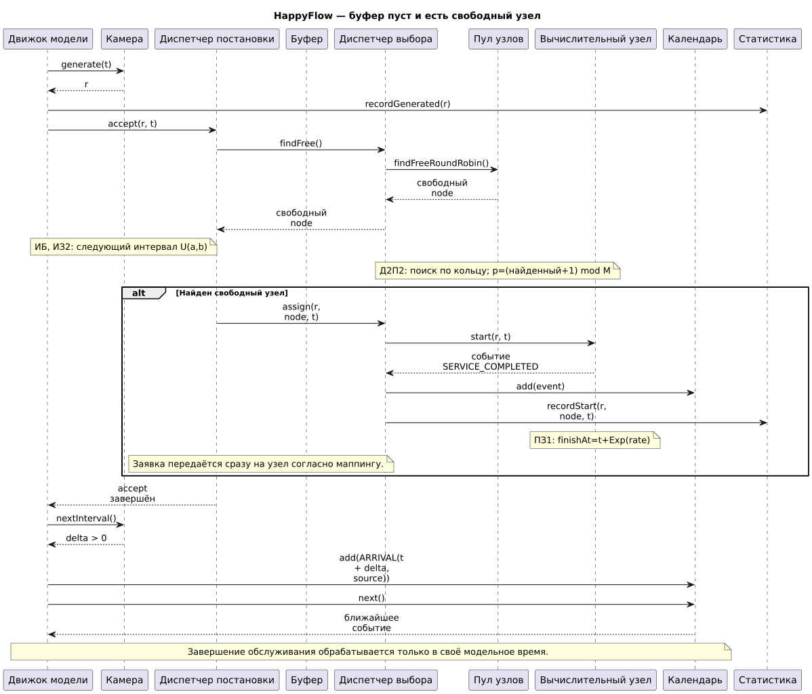
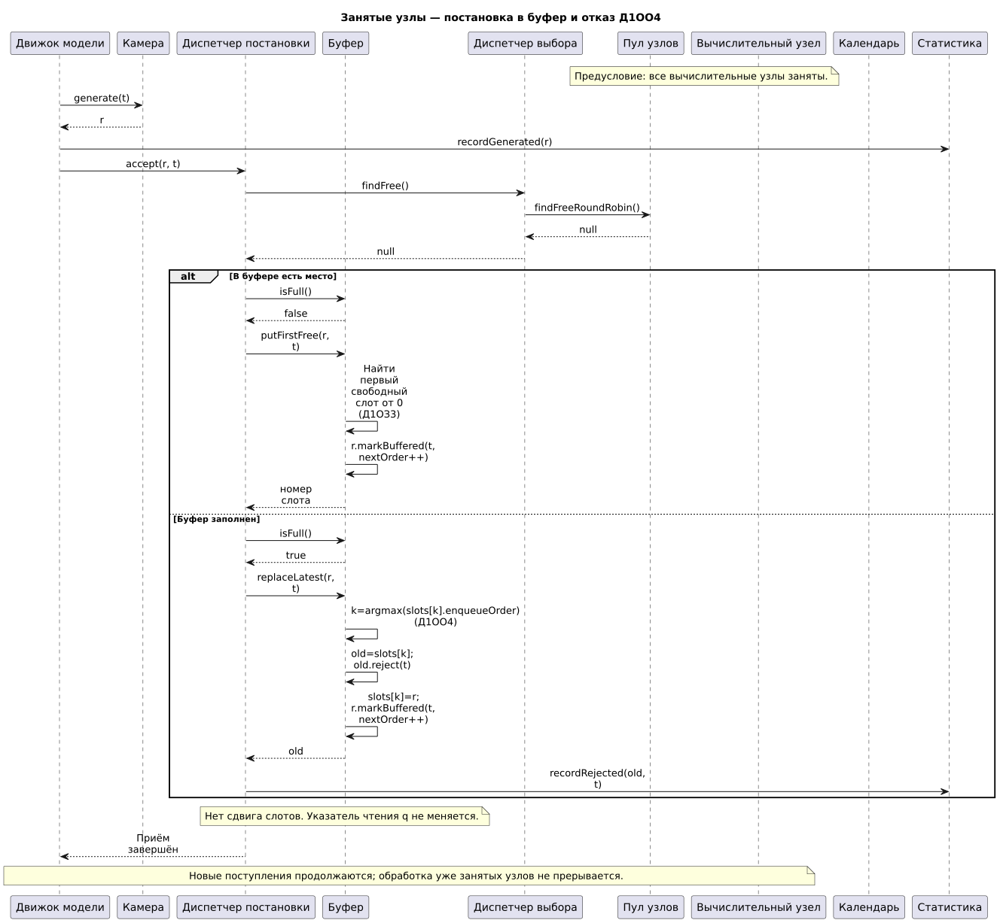
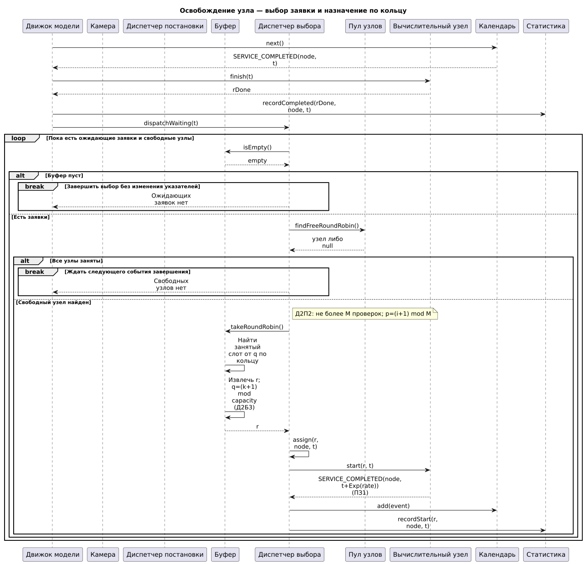
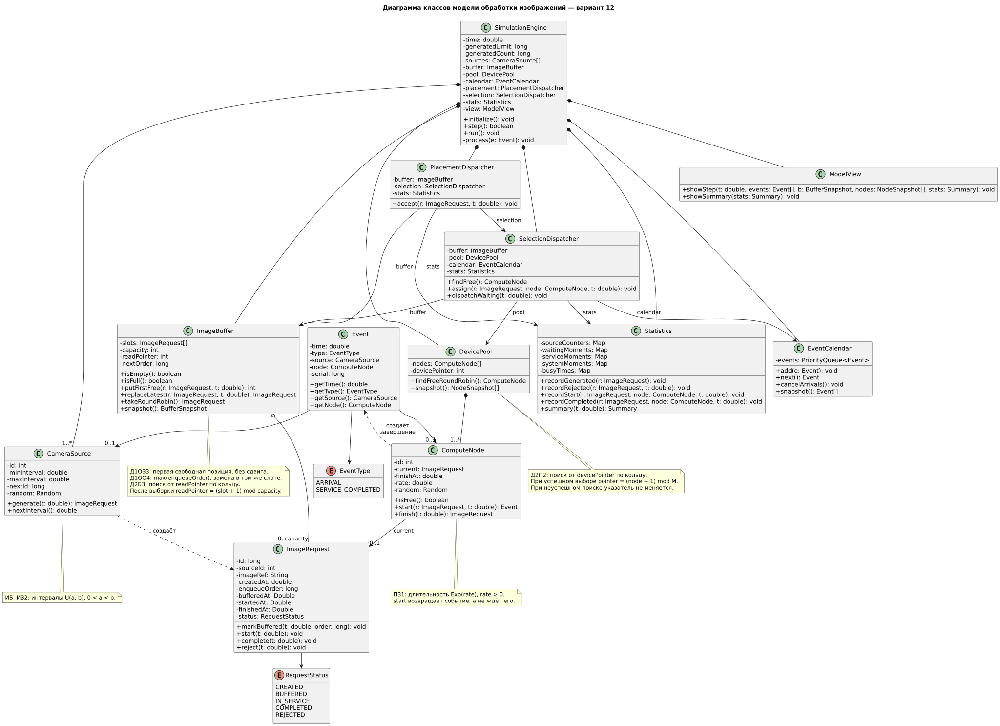
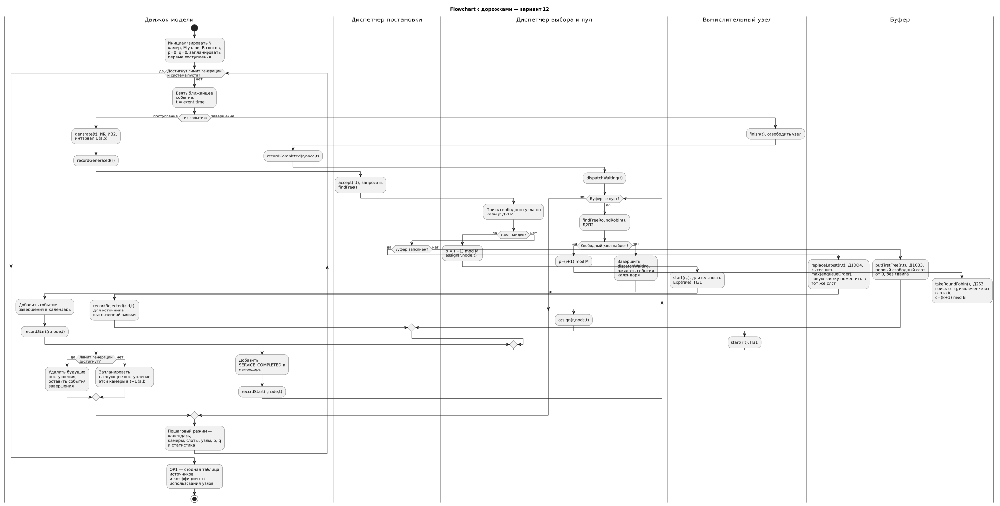

# Система распределённой обработки изображений с камер видеонаблюдения — вариант 12

Пилюгина М. А., группа 5130904/40106.


```text
ИБ  ИЗ2  ПЗ1  Д1ОЗ3  Д1ОО4  Д2П2  Д2Б3  ОР1  ОД3
```

## Первичные артефакты

В модели:
- источники СМО — камеры видеонаблюдения, генерирующие изображения для обработки;
- заявка — изображение, поступившее от камеры на анализ;
- буфер — общая ограниченная очередь со слотами для ожидания обработки;
- приборы СМО — вычислительные узлы, обрабатывающие изображения;
- диспетчер постановки направляет заявку свободному узлу либо размещает её в буфере и обрабатывает переполнение;
- диспетчер выбора назначает свободные узлы и извлекает ожидающие заявки по кольцу;
- статистика используется для формирования итоговых показателей моделирования.

| Код | Значение в варианте |
|---|---|
| ИБ | Бесконечные источники заявок |
| ИЗ2 | Равномерный закон распределения интервалов между генерациями заявок |
| ПЗ1 | Экспоненциальный закон распределения времени обслуживания |
| Д1ОЗ3 | Размещение новой заявки в первом свободном слоте от начала буфера, без сдвига остальных заявок |
| Д1ОО4 | При переполнении буфера отказ получает последняя поступившая в буфер заявка; новая помещается на её место |
| Д2П2 | Выбор свободного вычислительного узла по кольцу |
| Д2Б3 | Выбор ожидающей заявки из буфера по кольцу |
| ОР1 | Автоматический режим: сводная таблица результатов |
| ОД3 | Пошаговый режим: временные диаграммы и текущее состояние системы (визуализация временных диаграмм на этапе первичных артефактов не требуется) |

## Бизнес-домен

Моделируется система распределённой обработки изображений с камер видеонаблюдения. Камеры передают изображения для анализа, а вычислительные узлы обрабатывают поступившие задания.

| Компонент | Роль в модели СМО |
|---|---|
| CameraSource| Генерирует заявки на обработку изображений |
| ImageRequest| Хранит данные заявки, источник, время поступления и состояние |
| ImageBuffer| Хранит ожидающие заявки в ограниченном числе слотов |
| ComputeNode| Выполняет обслуживание заявки |

Заявка содержит идентификатор, номер камеры (`sourceId`), ссылку на изображение (`imageRef`), моменты поступления, постановки в буфер, начала и завершения обслуживания, а также текущее состояние.

Решения о размещении, отказе и выборе заявок определяются порядком поступления и кольцевыми указателями.

## Основная логика СМО

```text
CameraSource
     |
     v
SimulationEngine
     |
     v
PlacementDispatcher ------> SelectionDispatcher
     |                              |
     v                              v
 ImageBuffer  <---------------> DevicePool
                                    |
                                    v
                               ComputeNode
```

При поступлении изображения система сначала проверяет наличие свободного вычислительного узла. Если он найден, обработка начинается сразу. Если все узлы заняты, заявка помещается в первый свободный слот буфера. При полном буфере вытесняется последняя помещённая туда заявка, а новая занимает её слот. После завершения обслуживания узел освобождается и может получить следующую ожидающую заявку, выбранную по кольцу.

# Первичные артефакты

## Sequence Diagrams

### Основной сценарий — обычная обработка

Диаграмма показывает последовательность действий при штатном поступлении заявки:
- генерацию изображения камерой;
- регистрацию поступления;
- поиск свободного вычислительного узла по `Д2П2`;
- немедленное начало обслуживания при наличии узла либо помещение в буфер по `Д1ОЗ3`;
- планирование события завершения обслуживания.



Исходник: [`sequence/normal_processing.puml`](sequence/normal_processing.puml)

### Переполнение буфера

Отдельный сценарий, когда все вычислительные узлы заняты и нет свободных слотов:
- обнаружение заполненного буфера;
- поиск последней помещённой в буфер заявки по `Д1ОО4`;
- отказ вытесненной заявке;
- размещение новой заявки в освободившемся слоте;
- регистрацию отказа в статистике.



Исходник: [`sequence/buffer_overflow.puml`](sequence/buffer_overflow.puml)

### Завершение обслуживания

Диаграмма показывает:
- получение события `SERVICE_COMPLETED`;
- завершение обслуживания изображения;
- освобождение вычислительного узла;
- регистрацию статистики;
- выбор свободного узла по `Д2П2` и ожидающей заявки по `Д2Б3`;
- запуск обслуживания следующей заявки, если она существует.



Исходник: [`sequence/service_completed.puml`](sequence/service_completed.puml)

---

## Диаграмма классов

Основные классы:

| Класс | Назначение |
|---|---|
| `ImageRequest` | Заявка на обработку изображения |
| `CameraSource` | Источник, генерирующий изображения |
| `ImageBuffer` | Буфер фиксированной ёмкости с размещением и кольцевым выбором |
| `PlacementDispatcher` | Размещение заявок и обработка переполнения |
| `SelectionDispatcher` | Назначение заявок вычислительным узлам |
| `DevicePool` | Набор вычислительных узлов и указатель кольцевого выбора |
| `ComputeNode` | Прибор СМО, обрабатывающий изображение |
| `Event` | Событие поступления или завершения обслуживания |
| `EventCalendar` | Календарь запланированных событий |
| `SimulationEngine` | Управление модельным временем и событиями |
| `Statistics` | Сбор статистики по заявкам и приборам |
| `ModelView` | Отображение пошагового состояния и сводных результатов |

В диаграмме также представлены перечисления состояний и событий, а также структуры снимков состояния и итоговой статистики.



Исходник: [`class/class_diagram.puml`](class/class_diagram.puml)

---

## Flowchart с дорожками

Общая блок-схема показывает алгоритм обработки событий с разделением действий между движком модели, диспетчерами, буфером и вычислительными узлами.

Основные альтернативы:
- поступление заявки или завершение обслуживания;
- наличие свободного вычислительного узла;
- наличие свободного места в буфере;
- вытеснение последней заявки по `Д1ОО4`;
- постановка в первый свободный слот по `Д1ОЗ3`;
- кольцевой выбор узла `Д2П2` и заявки `Д2Б3`;
- достижение лимита генерации и завершение обслуживания оставшихся заявок.



Исходник: [`flowcharts/flowchart.puml`](flowcharts/flowchart.puml)

Дополнительные схемы алгоритмов:
- [Основной цикл событий](flowcharts/main_event_loop.puml) — работа календаря и движка моделирования;
- [Поступление заявки и работа буфера](flowcharts/arrival_buffer.puml) — размещение и вытеснение;
- [Завершение обслуживания и выбор заявки](flowcharts/completion_selection.puml) — освобождение узла и кольцевые алгоритмы.


---
